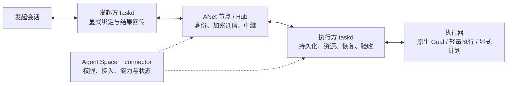

# Agent Space + taskd

跨电脑委派 Agent 任务，把执行、验收和结果回传连接起来。

Agent Space 管理账号、节点、权限和能力；taskd 在节点旁边保存任务、调度执行器、核对产物，并把结果送回发起会话。通信通过外部依赖 [ANet](https://github.com/ANetResearch/ANet) 完成。

**这是可阅读、可运行测试的研究实现。** 本仓库不包含生产账号、节点身份、模型登录、客户任务或运行数据库。模拟测试的通过不代表真实模型、Windows 桌面或跨网络交付已经验收。

## 架构



[在线交互架构页](https://kuan-er.github.io/agent-space/) · 完整说明：[架构与时序](docs/architecture.md) · [验证范围](docs/verification.md) · [自托管](docs/self-hosting.md) · [许可证边界](docs/licensing.md)

## 五分钟体验

Python 3.10+；前端逻辑检查还需要 Node.js。Python 服务和测试只使用标准库。原生 Goal 适配需要本机 Codex 提供对应 API；能力探针失败时会明确报告，不假定所有版本都支持。

```sh
git clone https://github.com/kuan-er/agent-space.git
cd agent-space
python3 examples/local_roundtrip.py
```

该演示在临时目录启动两个真实 taskd 守护进程，使用**模拟 ANet、模拟执行器、模拟发起会话服务**，核对提交、执行、程序验收、附件校验和会话回传。无需模型密钥或生产节点，不连接公共 Hub。

启动本地门户预览：

```sh
python3 agent-portal/server.py
# http://127.0.0.1:8890/architecture.html：无需登录的架构页
# http://127.0.0.1:8890/：门户；首次管理员入口在 agent-portal/.data/admin-setup-link.txt
```

默认 Hub 地址为本机回环地址。真实接入需要按[自托管说明](docs/self-hosting.md)配置自己的 ANet Hub、准入 helper 和节点身份。

## 代码导航

| 目录 | 内容 |
| --- | --- |
| `taskd/taskd/` | taskd/1 协议、任务引擎、状态存储、资源锁、恢复、验收、附件和回传 |
| `taskd/taskd/native.py` | 原生 Goal 生命周期与独立验收 |
| `taskd/taskd/lightweight.py` | 单次执行和所有者登记的有限参数 routine |
| `taskd/taskd/executors/`、`requesters/`、`transports/` | 执行器、发起会话、传输适配器 |
| `agent-portal/` | Python + SQLite 门户、connector、harness 桥接、静态前端 |
| `examples/` | 无模型的本地往返演示和任务规格 |
| `patches/anet/` | 针对明确上游版本的 ANet 修改补丁，使用独立许可证 |

当前 taskd 版本为 1.9.0。确定性状态查询不调用模型；小任务可执行一次；持续任务优先使用经探针确认的原生 Goal，也支持显式阶段计划。所有路径都保留预算、资源边界和验收记录。

## 验证

```sh
cd taskd
python3 -m unittest discover -s tests
cd ../agent-portal
python3 -m unittest discover -s tests
node --check static/app.js
node tests/test_execution_ui.js
```

`ci/github-actions.yml` 提供 Linux 完整回归和 macOS 平台检查模板；复制到 `.github/workflows/` 可启用。初次发布仅完成本地验证，未启用托管 CI。特定 OS 原语或可选预编译文件不可用时会明确跳过。详见[验证范围](docs/verification.md)。

## License

本仓库的独立 taskd、门户与 connector 代码使用 [Apache-2.0](LICENSE)。ANet 是 Agent Network Research 的项目；`patches/anet/` 及其构成的派生作品适用完整的 [ANet 许可证](patches/anet/LICENSE)，其附加条件不会被根目录许可证替代。ANet 的多租户 Hub 服务有额外授权条件；请阅读[许可证边界](docs/licensing.md)。

English: Agent Space is a team portal and node connector; taskd is a durable agent-task runtime with resource scheduling, independent acceptance, artifact verification and explicit return-to-session binding. The local demo uses simulated transport, executors and session APIs. ANet is an external, separately licensed dependency.
