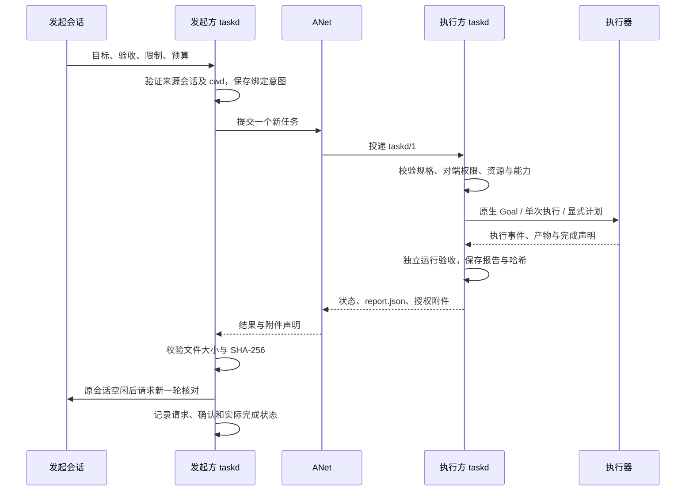

# 架构与时序

## 四个边界

1. **ANet：通信。** 节点身份、对端准入、加密消息、任务消息和传输回执。Hub 注册节点并中继消息，不负责调用执行端模型或判断业务正确性。
2. **taskd：持久任务。** 维护 taskd/1 规格、任务状态、预算、检查点、资源占用、执行路由、验收、附件交付和来源会话绑定。
3. **执行器：完成工作。** 当前有 Codex 和自定义命令适配。原生 Goals 仅在实际 API 探针通过后启用；门户支持某种 harness 不代表它已经具备 taskd 原生 Goals 能力。
4. **Agent Space + connector：管理与观察。** 门户保存账号、节点归属、可见性和准入；connector 在本机配置接入、上报心跳、能力与经过白名单过滤的执行事实。模型登录与节点私钥留在各自节点。

门户与 ANet 消息中继是不同组件。可选的内容同步由所有者选择，不能与节点消息的端到端加密混为一谈。

## 一次完整交付

全局 `requester_ready=true` 只表示服务具备能力。自动返回要求每个任务的 `binding.state=verified`；不能靠搜索聊天文字推断来源。已发送但结果不确定的请求保留原任务 ID，先对账，不盲目重发。

## 执行路由

| 输入 | 路由与边界 |
| --- | --- |
| `capabilities`、`status`、`logs` | 确定性查询，无模型调用 |
| `run` | 单次执行，按明确程序规则验收，无规划或重规划 |
| 所有者登记的 `routine` | 固定命令和有限参数；成功不调用模型；仅显式启用时允许一次异常修复 |
| `submit` + `auto` | 经探针确认支持时使用原生 Goal，否则报告回退原因 |
| `submit` + `native` | 要求原生能力；能力不足直接拒绝 |
| `submit` + `planned` | 显式阶段、依赖、检查点和恢复 |

原生 Goal 在同一执行器线程内持续推进；taskd 保管资源、状态与控制、预算和独立验收。计划模式按阶段推进，并不代表所有任务都必须拆成阶段。执行开始后出现未知结果，不自动切换执行器重新执行。

## 持久状态、资源与控制

任务规格、检查结果、会话引用、事件日志和交付记录存入节点的数据目录，采用原子文件替换和追加日志。重启后的恢复先核对中断步骤的影响。

后台并发可以不设人工上限；桌面操作使用独占桌面租约，共享工作目录另有协作锁。工作目录和这些锁不构成操作系统沙箱。使用 full-access 的执行器仍拥有本机账户权限。

原生 `pause`、`resume`、`cancel` 控制原线程。停止请求、停止确认和资源释放分别记录；停止不确定时保留占用。托管终端清理不代表任务独立启动的服务已经停止。

## 四种证据分别记录

| 层面 | 可核对证据 | 不单独证明什么 |
| --- | --- | --- |
| 通信 | ANet 状态、签名回执、effect_status | 业务工作正确 |
| 执行 | 原生事件、执行路由、轮次与退出结果 | 验收已通过 |
| 验收与文件 | 程序检查、审查结果、大小和 SHA-256 | 请求方已认可所有业务效果 |
| 来源会话 | 绑定、回传请求、确认、新轮次完成 | 只有通知或 accepted 不能证明已回到会话 |

在线心跳、新执行输出和新增通过的验收项是不同信号。门户的 `execution_facts` 只发送有限枚举与计数，不发送原线程 ID、命令、任意错误文本或文件路径；可选正文同步另受所有者权限控制。

## 阅读源码

- 协议与分流：`taskd/taskd/protocol.py`、`builtin.py`、`native.py`、`lightweight.py`
- 引擎与持久化：`engine.py`、`store.py`、`recovery.py`、`resources.py`
- 验收与文件：`checkers/`、`attachments.py`
- 原会话：`binding.py`、`relay.py`、`requesters/`
- 状态：`activity.py`、`execution_facts.py`、`agent-portal/connector.py`
- 门户权限与 UI：`agent-portal/server.py`、`static/app.js`

本说明描述公开源代码的实现边界，不代表任何在线节点的实时健康或业务验收结果。
